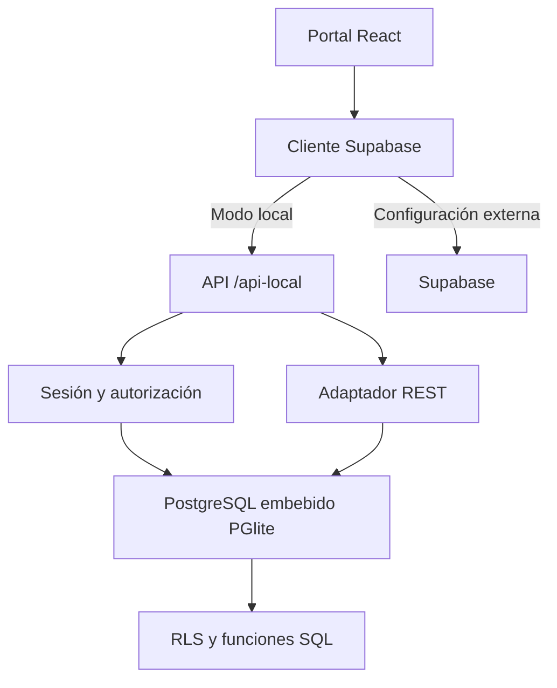

# SDD · Sprint 2 del Colegio Miraflores

## Arquitectura

Se adoptó un monolito modular con arquitectura por capas. La exportación incorpora un solo portal y tres módulos principales. La interfaz usa React y TanStack Start. La API local compatible con el cliente Supabase delega las reglas a PostgreSQL embebido con PGlite. Con credenciales externas, el cliente existente usa Supabase directamente.

| Capa | Código | Responsabilidad |
| --- | --- | --- |
| Presentación | `src/routes/`, `src/components/escolar/` | Formularios, navegación y acceso a funciones por rol. |
| API HTTP | `local/server.mjs`, `local/http/docs.mjs` | Sesión por solicitud, transporte JSON, adjuntos, contrato OpenAPI y Swagger UI. |
| Aplicación | `local/application/auth.mjs`, `local/rest.mjs` | Gestión de sesiones y adaptación de operaciones REST a consultas y funciones SQL. |
| Reglas de negocio | `drizzle/migrations/` | Políticas RLS, restricciones, funciones transaccionales y auditoría. |
| Persistencia | `local/database.mjs` | Inicialización, datos ficticios y contexto SQL del usuario autenticado. |

Se aplicó responsabilidad única al separar autenticación, transporte y documentación. El adaptador REST mantiene el contrato del cliente y encapsula la traducción hacia SQL. Las escrituras que afectan cupos, asistencia o respuestas a reclamos reutilizan las funciones de la base. El servidor HTTP recibe una conexión inicializada, lo que permite ejercitar el mismo controlador con una base aislada durante las pruebas. Las validaciones de React orientan al usuario y las reglas definitivas se aplican en SQL.

## Especificaciones funcionales

| ID | Historia | Criterios de aceptación | Tareas técnicas y evidencia |
| --- | --- | --- | --- |
| S2-01 | Secretaría registra y confirma una solicitud de matrícula. | Una matrícula activa por estudiante y periodo. La confirmación exige periodo abierto, documentos aprobados, pago completo, sección correspondiente y vacante. Ante dos confirmaciones por la última vacante, solo una prospera. | Documentar `POST /rest/v1/matriculas` y `confirmar_matricula`. Ejecutar pruebas HTTP con documentos, pagos y dos solicitudes concurrentes. Revisar índice único parcial y bloqueo de la sección. |
| S2-02 | El personal autorizado registra la asistencia por QR y puede cerrar el registro diario. | Un QR válido de un estudiante matriculado registra presente o tardanza con hora de Lima. Repetirlo conserva una marca. El cierre registra faltas para estudiantes sin marca. Un apoderado no puede registrar asistencia. | Documentar `marcar_asistencia_qr`, `cerrar_asistencia_qr` y `registrar_asistencia`. Verificar por API el rol, la repetición y la lectura filtrada. |
| S2-03 | El apoderado presenta un reclamo y recibe el aviso de resolución. | El reclamo empieza pendiente. Administración, Secretaría o Dirección pueden atenderlo. Resolver requiere una respuesta. Una resolución guarda fecha y responsable, genera aviso y evita otro cierre. | Documentar alta y consulta de reclamos y `responder_reclamo`. Probar alta, rechazo por rol, resolución, aviso y rechazo de un segundo cierre. |
| S2-04 | Cada familia consulta sus propios registros. | Sin sesión se devuelve 401. Las consultas con sesión muestran las filas permitidas por RLS. Las respuestas HTTP de datos incluyen `Cache-Control: no-store`. | Probar la misma ruta sin token, con apoderado y con administración. Publicar el contrato y exponer el estado de la base. |

## Base de datos y caché

El modo local guarda SQL y adjuntos en `datos-locales/`. Las pruebas usan una base en memoria y datos ficticios. La unicidad de matrícula activa se protege con `matricula_unica_activa`. Asistencia combina la unicidad por matrícula y fecha con el índice `asistencias_seccion_fecha` para el historial de cada sección. El expediente de matrícula, la ocupación de la sección y la notificación se actualizan en la misma transacción de confirmación.

TanStack Query conserva respuestas en memoria durante la sesión y vuelve a consultar según su ciclo de actualización. Los cambios en módulos como matrículas invalidan sus claves de consulta. El cierre de sesión limpia el cliente de consultas. Las respuestas de API no se guardan en caché HTTP compartida. Para que el resultado respete permisos, cada lectura vuelve a ejecutar RLS. El modo local usa una instancia embebida y no introduce una caché distribuida.

Los planes medidos con RLS están en [planes-db.txt](evidencias/planes-db.txt). La consulta de matrículas recorrió el índice parcial mediante un bitmap y devolvió ocho filas en 3,802 ms. La consulta de asistencia usó el índice de sección y fecha y devolvió cero filas en 0,024 ms. Estas mediciones usan la semilla local y representan el tiempo de ejecución SQL de dos consultas individuales.

## Validación y despliegue

El workflow `.github/workflows/sprint2.yml` instala con el archivo de bloqueo, ejecuta Jest, ejecuta Vitest, compila el portal y publica el informe de cobertura. El informe de validación explica los resultados de la demo e identifica los umbrales de carga que requieren revisarse con el Sprint 1.
